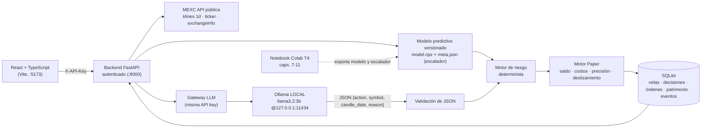

# Bot Financiero DL: agente de trading Paper con Deep Learning sobre datos reales de MEXC

> Proyecto de **Deep Learning para Finanzas** (Prof. Rubén Miguel Rodríguez Rangel).
> El proyecto va del pronóstico de rendimientos (capítulos 7 a 11 de *Deep Learning for Finance*, S. Kaabar) a un **agente de IA** que lee datos reales del par **BTC/USDT** en **MEXC**, consulta un modelo predictivo y un **LLM local (Ollama)**, pasa controles de riesgo deterministas y opera **solo en modo Paper** (dinero virtual), mostrando **operaciones y PnL** en un panel React + TypeScript.

**Las órdenes reales están deshabilitadas por diseño.** No existe código que envíe órdenes a MEXC; la ruta `/api/real/*` responde `403`. No se necesita ninguna clave de MEXC porque solo se consumen datos públicos.

---

## Índice
1. [Qué hace el sistema](#1-qué-hace-el-sistema)
2. [Arquitectura](#2-arquitectura)
3. [Estructura del repositorio](#3-estructura-del-repositorio)
4. [Instalación y ejecución paso a paso](#4-instalación-y-ejecución-paso-a-paso)
5. [Notebook de Colab (T4): capítulos 7 a 11](#5-notebook-de-colab-t4-capítulos-7-a-11)
6. [El agente: ciclo, riesgo y Paper](#6-el-agente-ciclo-riesgo-y-paper)
7. [API del backend](#7-api-del-backend)
8. [Manejo de errores y pruebas](#8-manejo-de-errores-y-pruebas)
9. [Resultados](#9-resultados)
10. [Versiones y avances](#10-versiones-y-avances)
11. [Correspondencia con las rúbricas](#11-correspondencia-con-las-rúbricas)
12. [Seguridad y secretos](#12-seguridad-y-secretos)
13. [Limitaciones y trabajo futuro](#13-limitaciones-y-trabajo-futuro)

---

## 1. Qué hace el sistema

| Pieza | Qué hace |
|---|---|
| **Datos** | Descarga velas diarias **cerradas** de BTC/USDT desde la API pública de MEXC (`/api/v3/klines`, UTC, desde 2020-01-01, más de 2,100 velas). Excluye la vela abierta, audita los datos (duplicados, orden, huecos, no finitos y precios ≤ 0) y no rellena ni inventa volumen. |
| **Modelo** | Pronostica el rendimiento del día siguiente $y_t = P_{t+1}/P_t - 1$ con los 20 rendimientos más recientes, más `dist_sma20` y `vol20` (contrato de variables `v1`). Compara el pronóstico cero, la regresión lineal, MLP y LSTM. |
| **Señal** | Comprar o mantener si el pronóstico supera un umbral δ (y, si se eligió en VA, si el cierre está sobre la SMA20); en otro caso, efectivo. |
| **Agente** | Repite el ciclo: velas de MEXC, variables, pronóstico, propuesta (LLM local o regla del modelo), validación del JSON, riesgo determinista, ejecución Paper, SQLite y UI. |
| **Panel** | Precio en vivo de MEXC, pronóstico, indicadores, acción propuesta y motivo, estado de riesgo, posición, patrimonio, **operaciones con PnL**, curva de patrimonio contra comprar y mantener, comparación de corridas, bitácora de errores y botones **Iniciar / Pausar / Reanudar / Detener / Liquidar**. |

## 2. Arquitectura



- **El LLM nunca recibe claves y no puede saltarse el riesgo.** Solo propone una acción de una lista permitida; el motor de riesgo decide.
- **Ollama corre local** y solo el backend puede consultarlo; Ollama no trae autenticación por defecto, así que la capa de API key está implementada en el backend.
- **La inferencia del modelo no necesita TensorFlow ni PyTorch en el servidor.** El notebook exporta los pesos y `backend/app/model.py` reproduce la red en NumPy. Al cargar el modelo, el backend comprueba que reproduce 8 predicciones de referencia del entrenamiento (prueba de contrato).

## 3. Estructura del repositorio

```
bot-financiero-dl/
├── README.md                      ← este archivo
├── .gitignore                     ← excluye .env, bases de datos y node_modules
├── notebook/
│   ├── DL_Finanzas_BTCUSDT_MEXC.ipynb   ← práctica caps. 7-11 (ejecutar en Colab con T4)
│   └── build_notebook.py               ← genera el .ipynb (fuente versionable del notebook)
├── backend/
│   ├── .env.example               ← plantilla de configuración SIN secretos
│   ├── requirements.txt
│   ├── config/risk.json           ← límites de riesgo (el LLM no puede cambiarlos)
│   ├── models/current/            ← modelo en uso: model.npz + meta.json (versionado)
│   ├── app/
│   │   ├── main.py      ← API FastAPI, autenticación, gateway del LLM
│   │   ├── agent.py     ← ciclo del agente, control humano, recuperación tras reinicio
│   │   ├── paper.py     ← motor de riesgo determinista y simulador Paper
│   │   ├── llm.py       ← cliente Ollama y validación estricta del JSON
│   │   ├── mexc.py      ← cliente de datos públicos de MEXC (solo lectura)
│   │   ├── features.py  ← contrato de variables v1 (igual que en el notebook)
│   │   ├── model.py     ← carga del modelo y escalador, inferencia NumPy (MLP/LSTM/lineal)
│   │   ├── backtest.py  ← simulación vectorial y métricas
│   │   ├── config.py, db.py
│   ├── scripts/train_cpu_baseline.py   ← modelo provisional v0 en CPU
│   └── tests/test_controls.py          ← 16 pruebas automatizadas de controles
├── frontend/                      ← React 18 + TypeScript + Vite
│   └── src/ (App.tsx, Charts.tsx, api.ts, styles.css)
├── data/raw, data/processed       ← datos originales y procesados (CSV)
├── reports/                       ← experimentos, umbrales, simulaciones exportadas
└── docs/                          ← presentación ejecutiva y evidencias
```

## 4. Instalación y ejecución paso a paso

### Requisitos
| Herramienta | Versión probada | Para qué |
|---|---|---|
| Python | 3.14.4 (funciona con ≥ 3.11) | backend |
| Node.js / npm | 24.15 / 11.12 | frontend |
| Ollama | 0.40.x | LLM local |
| Modelo LLM | `llama3.2:3b` (~2 GB) | propuestas del agente |
| Git | 2.x | repositorio |
| Google Colab | GPU **NVIDIA T4** | entrenamiento profundo (obligatorio) |

### 4.1 Backend
```powershell
cd backend
python -m pip install -r requirements.txt
copy .env.example .env
python -c "import secrets;print(secrets.token_urlsafe(32))"
```
Pegue la clave generada en `AGENT_API_KEY=` dentro de `backend/.env`. Luego:
```powershell
python -m uvicorn app.main:app --port 8000
```
Documentación interactiva de la API: http://127.0.0.1:8000/docs

> Si `backend/models/current/` está vacío, ejecute `python -m scripts.train_cpu_baseline`, que descarga los datos de MEXC y entrena el modelo provisional v0, o copie la exportación del notebook (sección 5.3).

### 4.2 LLM local (Ollama)
```powershell
winget install Ollama.Ollama
ollama pull llama3.2:3b
ollama run llama3.2:3b "hola"
```
Ollama escucha en `127.0.0.1:11434` (solo local). Verifique la inferencia local desde el panel (**Gateway del LLM local**) o con `GET /api/llm/info`, que muestra la versión de Ollama y los modelos descargados.

### 4.3 Frontend
```powershell
cd frontend
npm install
npm run dev
```
Abra http://localhost:5173 y escriba la `AGENT_API_KEY`. La clave **no** está en el código del frontend: se guarda solo en `sessionStorage` de la pestaña.

### 4.4 Uso rápido
1. **Modo**: *Replay histórico* (repite velas pasadas, identificado como replay) o *Live MEXC* (procesa cada vela diaria nueva cuando cierra a las 00:00 UTC).
2. **Estrategia**: *Modelo sin LLM* (regla del modelo) o *Agente con LLM* (Ollama propone y el riesgo valida).
3. **Iniciar**. Las operaciones, el PnL y la curva de patrimonio se actualizan cada 2.5 s.
4. **Pausar / Reanudar / Detener**. *Detener* bloquea nuevas órdenes **sin liquidar**; para cerrar la posición use **Liquidar posición** (acción explícita).
5. Para la comparación que pide la rúbrica, corra replays con el mismo número de días en ambas estrategias. La tabla muestra rendimiento neto, comprar y mantener, drawdown, operaciones, Win Rate, acciones rechazadas y latencia del LLM.

## 5. Notebook de Colab (T4): capítulos 7 a 11

### 5.1 Cómo ejecutarlo
1. Suba `notebook/DL_Finanzas_BTCUSDT_MEXC.ipynb` a Google Colab.
2. *Entorno de ejecución → Cambiar tipo de entorno → **GPU T4***.
3. *Ejecutar todo*. Autorice Google Drive cuando lo pida; las salidas se guardan en `MyDrive/bot_financiero_dl/`.
4. Al final se descarga `entrega_dl_finanzas.zip` con datos, modelos, checkpoints, CSV y figuras.

**Si no detecta una T4, el notebook se detiene** y registra el incidente en la bitácora (regla del protocolo). La variable `ALLOW_CPU_TEST=1` existe solo para probar el código fuera de Colab; esa salida **no** es evidencia.

### 5.2 Contenido por capítulo
| Sección | Capítulo | Qué contiene |
|---|---|---|
| 0 | — | Evidencia T4: `nvidia-smi`, operación en la GPU, versiones, semilla y `evidencia_t4.txt` |
| 1 | 7 / 11 | Ficha del activo, descarga MEXC con metadatos, diccionario, auditoría, rendimientos extremos y gráficas de precio, rendimiento y volatilidad |
| 2 | 7 | Objetivo, partición TR/VA/TE por fecha del objetivo (70/15/15) con verificación, **fila de control de aprendizaje**, pronóstico cero y regresión lineal (MAE, RMSE y DA en TR y VA), hipótesis técnica |
| 3 | 8 | MLP y LSTM en T4 (forma `ejemplos × 20 × variables`), tres configuraciones por red, parada temprana con VA y restauración de pesos, curvas TR/VA, tres semillas (media ± desviación), checkpoints |
| 4 | 9 | Tres ventanas expansivas dentro de TR (escalador reajustado en cada una), cinco umbrales δ en VA, diferenciación fraccionaria |
| 5 | 10 | Entorno `TradingEnv`: estado, acciones, restricciones, recompensa neta de costos, **transición manual calculada**, prueba anti-explotación, DQN/DDQN |
| 6 | 11 | Indicadores documentados (fórmula, ventana, primera fecha válida), comparación **A rezagos vs B rezagos + indicadores**, redundancia, predicciones casi constantes, **C solo pronóstico vs D con filtro SMA20** |
| 7 | transversal | **Cuatro fallos provocados**: conjunto vacío, fecha duplicada, valor no válido y dimensiones incorrectas |
| 8 | 7 / 9 | Controles antes de TE, configuración congelada con hash, **evaluación única en TE**, simulación (100,000 USDT, 0.10% por lado, ejecución en la apertura de t+1), comprar y mantener, efectivo, `predicciones_TE.csv`, `prediccion_futura.csv` |
| 9 | — | Exportación: `experimentos.csv`, `bitacora_errores.csv`, `simulacion.csv`, modelo, escalador y zip |
| 10 | — | Resumen automático y plantilla de reflexión por capítulo |

### 5.3 Usar el modelo de Colab en el agente
Del zip, copie `modelos/final/` (o `modelos/dl_best/` para usar el mejor modelo profundo) a `backend/models/current/` y reinicie el backend. Al arrancar se verifica:
- el contrato de variables (`feature_contract = v1`);
- que la inferencia en NumPy reproduce las predicciones de PyTorch (`check_x` / `check_y`).

## 6. El agente: ciclo, riesgo y Paper

**Ciclo obligatorio** (`backend/app/agent.py`):
1. Consulta las velas **cerradas** de MEXC y valida activo, orden, duplicados, valores y antigüedad.
2. Calcula las variables con la **misma definición** del entrenamiento (`features.py`) y obtiene el pronóstico.
3. Con la estrategia LLM, consulta Ollama con **datos estructurados**: precio, SMA20, distancias, RSI, pronóstico, señal del modelo, posición y acciones permitidas.
4. Exige un JSON `{action, symbol, candle_date, reason}` y valida tipos, acción, símbolo y fecha. Si el JSON es inválido, hace un reintento; si vuelve a fallar, rechaza la propuesta y no opera.
5. Aplica el **riesgo determinista** (`paper.py`).
6. Ejecuta en **Paper** y guarda la decisión, la orden, el patrimonio y los eventos. Es **idempotente**: hay una sola decisión por vela y por corrida (`UNIQUE(run_id, candle_date)`).
7. La UI muestra el resultado y el agente espera la siguiente vela (live) o avanza (replay).

**Configuración de riesgo** (`backend/config/risk.json`, fijada antes de la prueba; solo se cambia con la API key y con el agente detenido):

| Parámetro | Valor | Significado |
|---|---|---|
| `initial_capital` | 50,000 USDT | capital inicial del agente |
| `fee_rate` | 0.0% | costo por compra o venta (protocolo, sección 15; MEXC 0 fees) |
| `slippage_bps` | 2 pb | **supuesto de deslizamiento**: la compra se ejecuta 0.02% más cara y la venta 0.02% más barata |
| `max_exposure` | 95% | máximo del patrimonio invertido en BTC |
| `max_daily_loss` | 5% | si el patrimonio cae 5% en el día, se bloquean compras |
| `max_drawdown_halt` | 25% | si el drawdown supera 25%, el agente se detiene (solo permite vender) |
| `max_data_age_hours` | 30 h | si la última vela cerrada es más antigua, se bloquean órdenes |
| `allowed_symbols` | BTCUSDT | cualquier otro símbolo se rechaza |

**Simulador Paper:** respeta saldo (no compra más que el efectivo incluyendo costos), **tamaño mínimo y precisión del par** (leídos de `exchangeInfo` de MEXC: paso 0.000001 BTC, precio con 2 decimales, mínimo 1 USDT), costos y momento de ejecución:
- En **replay**, la señal del cierre de *t* se ejecuta en la **apertura de t+1** y el patrimonio se valora al cierre de *t+1*.
- En **live**, se ejecuta al último precio de MEXC tras el cierre de la vela.

Las ejecuciones y los rechazos quedan registrados. Sin apalancamiento ni ventas en corto.

## 7. API del backend

Todas las rutas requieren la cabecera `X-API-Key`, excepto `/api/health`.

| Método | Ruta | Descripción |
|---|---|---|
| GET | `/api/health` | vivo; confirma `real_orders: disabled` |
| GET | `/api/status` | estado del agente, cartera, última decisión, modelo y riesgo |
| GET | `/api/market` | ticker en vivo de MEXC, última vela cerrada, indicadores y **pronóstico del siguiente día** |
| POST | `/api/agent/start` | `{mode: replay\|live, strategy: model\|llm, replay_days}` |
| POST | `/api/agent/pause` · `/resume` · `/stop` · `/liquidate` | control humano |
| GET | `/api/runs` · `/api/runs/{id}` | métricas por corrida (con comprar y mantener), patrimonio, decisiones y órdenes |
| GET | `/api/events` | bitácora de eventos y errores |
| PUT | `/api/config/risk` | cambiar límites (solo con el agente detenido) |
| GET | `/api/llm/info` · POST `/api/llm/query` | gateway del LLM local: versión, modelos y consulta con latencia |
| POST | `/api/faults/{tipo}` | demostración de errores: `mexc_down`, `stale_data`, `ollama_down`, `invalid_json`, `insufficient_balance`, `duplicate_event` |

## 8. Manejo de errores y pruebas

### 8.1 Los nueve errores del protocolo
| Error | Cómo se demuestra | Respuesta del sistema |
|---|---|---|
| API sin respuesta o con límite (429) | botón *API MEXC sin respuesta* o red caída | 3 reintentos con espera creciente (1, 2 y 4 s); después **pausa** el agente (`halted`) y registra el evento |
| Dato atrasado | botón *Dato atrasado* (modo live) | la orden se **bloquea** (`BLOCKED`) con la antigüedad en horas |
| Ollama detenido | cerrar Ollama o botón | 2 reintentos; luego pausa nuevas decisiones; no opera |
| JSON inválido | botón *JSON inválido* | propuesta **rechazada** y registrada; la acción final es HOLD |
| Clave incorrecta | entrar con otra clave o llamar sin cabecera | `401` y evento `auth` registrado |
| Saldo insuficiente | botón *Saldo insuficiente* | orden **rechazada** (`REJECTED`) con el motivo |
| Evento duplicado | botón *Evento duplicado* | se ignora por idempotencia; no se duplican operaciones |
| Reinicio del backend | detener uvicorn y volver a iniciarlo | la corrida se recupera de SQLite **en pausa**, sin duplicar velas ya procesadas |
| Botón de detención | *Detener* | bloquea nuevas órdenes y muestra la posición abierta; *Liquidar* es una acción aparte |

### 8.2 Pruebas automatizadas
```powershell
cd backend
python -m pytest -q tests
```
Resultado actual: **16 passed**. Cubren la validación de datos (vacío, duplicado, no finito, ventana insuficiente), la exclusión de la vela abierta, el contrato del modelo, el riesgo (saldo, dato atrasado, sin cortos ni recompras, símbolo, detención, pérdida diaria), el JSON del LLM, Ollama caído, la idempotencia, la recuperación tras reinicio, MEXC caído, la detención y la API sin clave o con clave incorrecta.

## 9. Resultados

> Las cifras de esta sección salen de la ejecución en CPU del **modelo provisional v0** (`backend/scripts/train_cpu_baseline.py`). Hay que reemplazarlas con las del notebook ejecutado en **Colab T4** (sección 5) antes de la entrega final.

### 9.1 Particiones (BTC/USDT, MEXC, diario UTC)
| Conjunto | Desde | Hasta | Ejemplos |
|---|---|---|---|
| TR (70%) | 2020-01-21 | 2024-11-04 | 1,750 |
| VA (15%) | 2024-11-05 | 2025-11-14 | 375 |
| TE (15%) | 2025-11-15 | 2026-11-24 | 375 |

### 9.2 Modelo provisional v0 (CPU)
- En VA, la **regresión lineal con rezagos e indicadores** tuvo el menor RMSE (0.02321), por delante de los MLP de scikit-learn. Por eso es el modelo provisional. Regla elegida en VA: δ = 0.20% sin filtro SMA20.
- **TE, simulación con 100,000 USDT y 0.10% por lado:** estrategia **−27.8%** frente a comprar y mantener **−37.5%** (BTC cayó de ~95k a ~60k USDT en TE). Drawdown máximo: 33.5% contra 39.5%. 79 operaciones, Win Rate 45.6%, costos 12,488 USDT.
- **Agente Paper, replay de 90 días (2026-08-28 → 2026-11-25), 50,000 USDT, 0% de costo:** **+0.14%** (PnL +70.59 USDT) frente a comprar y mantener **−24.7%**. 90 ciclos, 45 operaciones, Win Rate 45.5%, drawdown máximo 11.8%.

### 9.3 Lectura honesta
- La estrategia pierde menos que comprar y mantener en mercados bajistas porque pasa a efectivo, pero **en TE no obtuvo rentabilidad positiva**. El protocolo pide "+20%"; la rúbrica aclara que "no se exige obtener ganancias ni superar al modelo sencillo". Se reportan las cifras reales, sin ajustar el sistema después de ver TE.
- Superar al pronóstico cero en RMSE con rendimientos diarios es difícil: la señal útil es pequeña frente al ruido.
- Si la versión Colab (MLP/LSTM en T4) no supera a la regresión lineal en VA, se reporta así y se exporta igualmente `dl_best` para el agente.

## 10. Versiones y avances

| Versión | Fecha | Avance | Contenido |
|---|---|---|---|
| **v0.1** | 2026-11-26 | Avance 1 (cap. 7) | Descarga MEXC paginada y auditoría, contrato de variables v1, partición TR/VA/TE por fecha del objetivo, pronóstico cero y regresión lineal |
| **v0.2** | 2026-11-26 | Avance 2 (cap. 8) | MLP y LSTM en PyTorch con parada temprana, tres configuraciones, tres semillas y evidencia de T4 en el notebook |
| **v0.3** | 2026-11-26 | Avance 3 (cap. 9) | Ventanas expansivas, umbrales δ en VA, simulación con ejecución en la apertura de t+1 |
| **v0.4** | 2026-11-26 | Avance 4 (cap. 10) | `TradingEnv` con estado, acciones, recompensa neta, transición manual y prueba anti-explotación |
| **v0.5** | 2026-11-26 | Avance 5 (cap. 11) | Indicadores `dist_sma20` y `vol20`, comparación A/B y C/D, TE único, pronóstico futuro y cuatro fallos provocados |
| **v0.6** | 2026-11-26 | Proyecto final | Backend FastAPI autenticado, cliente MEXC, motor de riesgo, Paper, SQLite, modelo provisional v0 en CPU |
| **v0.7** | 2026-11-26 | Proyecto final | Gateway y cliente Ollama local con validación JSON; estrategias con y sin LLM |
| **v0.8** | 2026-11-26 | Proyecto final | Panel React + TypeScript: precio en vivo, pronóstico, operaciones, PnL, comparación y bitácora |
| **v0.9** | 2026-11-26 | Proyecto final | Inyección de fallos, 16 pruebas automatizadas, recuperación tras reinicio |
| **v1.0** | 2026-11-27 | Entrega | README, presentación ejecutiva y modelo de Colab T4 integrado |

## 11. Correspondencia con las rúbricas

**Práctica (100 pts):** Datos (§5.2 sec. 1) · TR/VA/TE (sec. 2 y 8) · Referencias y modelos (sec. 2 y 3) · T4 (sec. 0 y 3) · Validación y estudio técnico (sec. 3, 4 y 6) · Estimaciones (sec. 8) · Manejo de errores (sec. 7 y bitácora) · Agente y simulación (sec. 5 y 8) · Reproducibilidad (sec. 9 y 10).

**Proyecto final (100 pts):**

| Criterio | Evidencia en el repositorio |
|---|---|
| Integración y modelo | `models/current/meta.json` versionado con su escalador; Ollama local (`/api/llm/info`); UI React + TS |
| API privada y secretos | `require_key` en `main.py`, pruebas 401; `.env` fuera del repo, `.env.example` sin valores |
| Datos MEXC y Paper | `mexc.py` (velas cerradas y fechadas), `paper.py` (saldo, costos, precisión), `/api/real/*` → 403 |
| Ciclo del agente | `agent.py` (7 pasos), `llm.py` (JSON validado), bucle live con `LIVE_POLL_SECONDS` |
| Riesgo y control humano | `risk.json` + `check()`; botones Iniciar, Pausar, Reanudar, Detener y Liquidar |
| Errores y persistencia | 9 escenarios (§8), SQLite idempotente, tabla `events` |
| Evaluación | tabla de corridas: modelo sin LLM, agente con LLM y comprar y mantener |
| Entrega reproducible | este README, `.env.example`, `requirements.txt`, `package.json` |

## 12. Seguridad y secretos
- `AGENT_API_KEY` vive solo en `backend/.env`, que está en `.gitignore`. Nunca se registra en logs ni se devuelve en `/api/status`.
- El frontend no contiene secretos ni variables `VITE_*` con claves.
- Iniciar, detener, liquidar y cambiar la configuración también requieren la clave.
- No se usa ninguna clave de MEXC. Si en el futuro se usara una de solo lectura, no debe tener permisos de trading ni de retiro.
- Los datos externos (incluida la respuesta del LLM) se tratan como **datos**: el LLM no puede cambiar reglas ni pedir secretos.

## 13. Limitaciones y trabajo futuro
- Un solo activo (BTC/USDT) y un solo periodo de prueba; los costos y el deslizamiento son supuestos académicos.
- La frecuencia es diaria: en modo live solo hay una decisión nueva por día. Los 20 o más ciclos de la demostración se obtienen en **replay**, identificado como tal.
- Siguiente paso: convertir `TradingEnv` en el entorno de entrenamiento y entrenar **DQN/DDQN** con una prueba independiente nueva.

*Simulación educativa. No es asesoría de inversión.*
